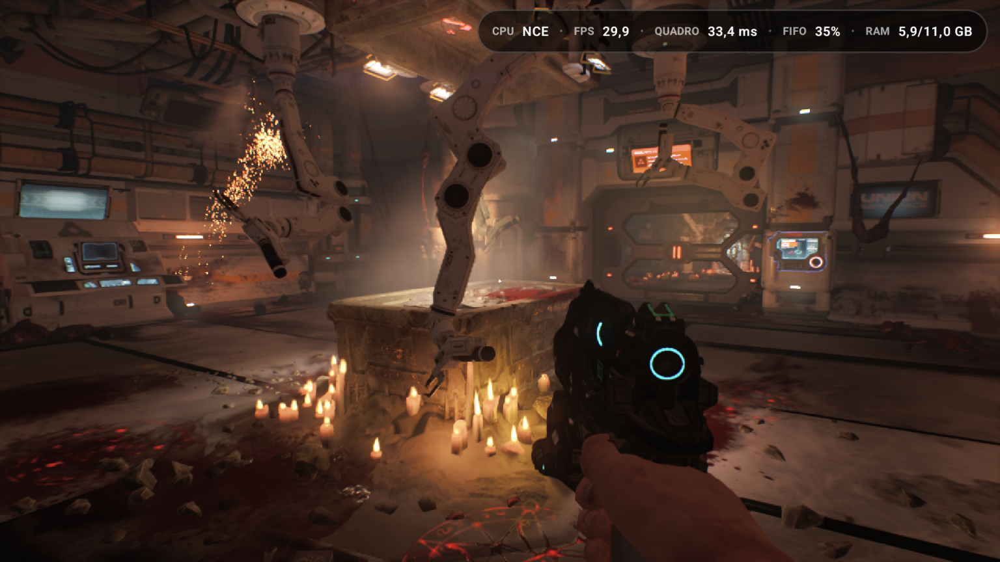
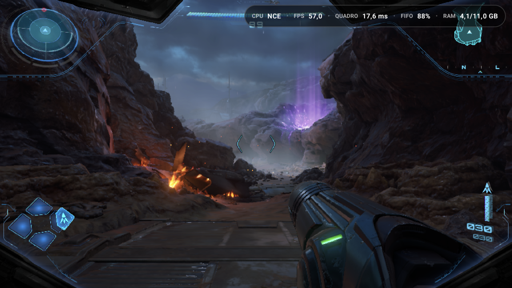
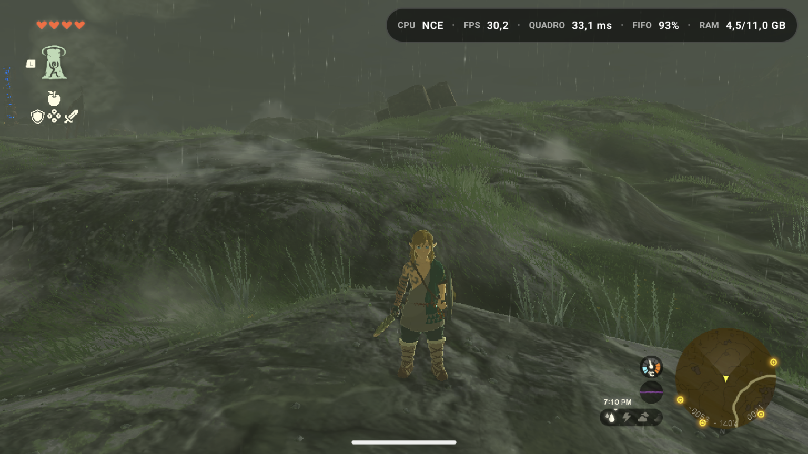
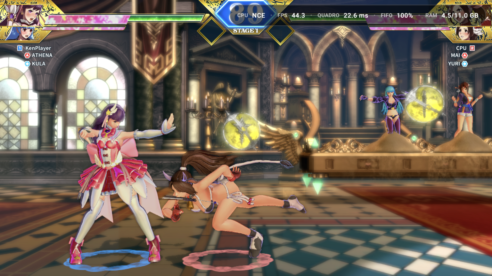
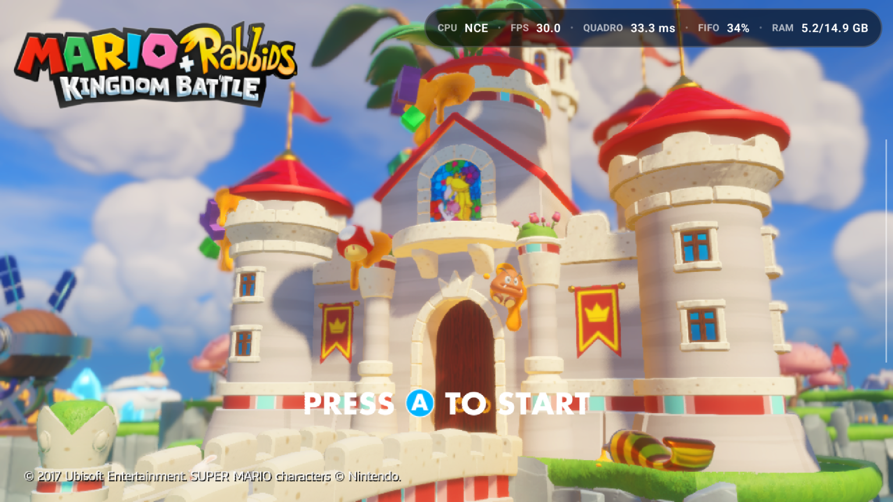
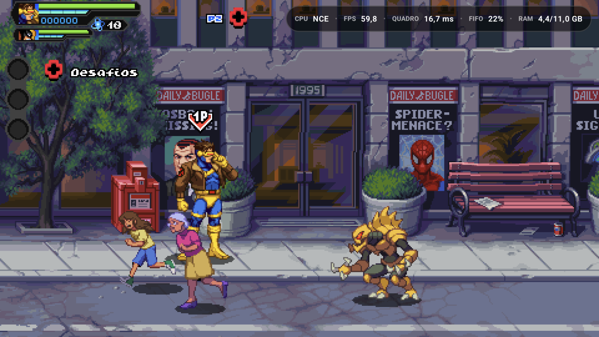

  <picture>
    <source media="(prefers-color-scheme: dark)" srcset="Imagens/Ryujinx%20Neo%20Logo.png">
    
  </picture>

  <h1>Ryujinx Neo</h1>
  
<strong>A personal, experimental Nintendo Switch emulation project for Android.</strong>

> [!IMPORTANT]
> This is an independent fork. It is not an official version of Ryujinx, Kenji-NX, Ryubing, or Eden and has no affiliation with Nintendo. The project does not include games, firmware, keys, or third-party protected content.

## Game gallery

Real screenshots from my tests of Ryujinx Neo on Android with games that did not work in Eden on my device. The FPS shown in each image is an instantaneous reading, not an average performance measurement.

<table>
  <tr>
    <td width="50%" align="center"></td>
    <td width="50%" align="center"></td>
  </tr>
  <tr>
    <td width="50%" align="center"></td>
    <td width="50%" align="center"></td>
  </tr>
  <tr>
    <td width="50%" align="center"></td>
    <td width="50%" align="center"></td>
  </tr>
  <tr>
    <td width="50%" align="center"></td>
    <td width="50%" align="center"></td>
  </tr>
  <tr>
    <td width="50%" align="center"></td>
    <td width="50%" align="center"></td>
  </tr>
</table>

**DOOM (2016)** is a special case: Kenji-NX would not boot the game, and in my tests, Eden did not render its textures. In Neo, the scene appears rendered in the screenshot above.

## Why the project started

Ryujinx Neo started for a simple, personal reason: I wanted to play some titles that, on my device and in the version of Eden I was using, did not run the way I needed. Kenji-NX's Android line offered another technical path. I began studying it, testing hypotheses, and adapting the code for the games and devices I have at hand.

The name **Neo** represents this work of experimental evolution: NCE tweaks, GPU/Vulkan work, per-game compatibility, and a custom Android interface. The goal is to learn, improve the experience, and share what works, without promising universal compatibility or identical performance on every device.

This is a **personal project**, maintained in my free time. It is not a commercial product or an official continuation of any project mentioned here.

## Where the code comes from

The origin should be clear:

| Project | Relationship to Ryujinx Neo |
| --- | --- |
| [Ryujinx](https://github.com/Ryujinx) | The original emulator project, created by **gdkchan**. Its architecture and the work of its contributors form the historical foundation. |
| [Kenji-NX](https://github.com/Kenji-NX) | The direct base of this fork, especially the Android/Bionic line. The old Kenji-NX README was still in this repository when Neo was started. The [historical code address](https://git.ryujinx.app/projects/Kenji-NX) may no longer be available. |
| [Ryubing](https://github.com/Ryubing) | Community continuation of the Ryujinx ecosystem; fixes and behavior are studied as references when relevant. |
| [Eden](https://git.eden-emu.dev/eden-emu/eden/) | Technical reference for some ideas and CPU/GPU comparisons. It was also part of the personal motivation to try another path for games that did not work in my context. |
| [Strato](https://github.com/strato-emu/strato) and earlier Neo/Gezinjinx experiments | Study and comparison references for Android, NCE, and graphics; appearing in this list does not mean all code from those projects has been incorporated. |
| [Mesa/Turnip](https://gitlab.freedesktop.org/mesa/mesa) and [Vulkan](https://www.khronos.org/vulkan/) | Drivers, API, and documentation used to investigate the graphics backend. |

Neo's own changes can be traced through the [history of the `neo-v2-nce2` branch](https://github.com/Sunshinin11/Ryujinx_Neo/commits/neo-v2-nce2). When an idea or implementation comes from another project, I try to record that origin in the commits. Original credits and licenses remain valid; see [LICENSE.txt](LICENSE.txt) and [THIRDPARTY.md](distribution/legal/THIRDPARTY.md).

## Development transparency: vibe coding

**Yes, this project uses vibe coding and artificial intelligence tools.** I use them to study code, compare approaches, propose and implement changes, review errors, and write documentation. This is part of the process and will not be hidden or presented as work written entirely by hand.

I define the problems I want to solve, choose what to experiment with, and test the results on the devices and games I have access to. AI assistance does not guarantee that a change is correct. Some of the code may be experimental, contain regressions, or still lack broad validation. For this reason, the repository keeps history, per-game options, and documentation of positive **and negative** results.

Contributions from other people, inherited bases, and external references must receive proper credit. If you find a missing or incorrect attribution, open an issue indicating the excerpt and the source.

## What Neo adds

- Portuguese-language Android interface, custom visual identity and logo, library in **NEO** and **Switch** modes, per-game profiles, and a quick menu during emulation.
- Experimental improvements to the Vulkan/Turnip backend: submissions, synchronization, cache, texture formats, and use of the backend on fast cores when applicable.
- Work on **NCE Neo 2**, optional memory protection, and compatibility tweaks for specific games.
- Global and per-game controls for NCE/JIT, Dock/Handheld mode, Memory Slack, shaders, VSync, resolution, graphics driver, and other options.
- Vulkan driver manager with system or custom driver selection, download catalog, and package integrity checks.
- Management of updates, DLCs, mods, cheats, saves, Amiibo, and caches through the interface.

[CHANGELOG.md](CHANGELOG.md) details what was added, fixed, and observed. Some options exist precisely so that an optimization can be disabled in a game with a regression.

## Project status

The Android version identified in the code of this branch is **0.0.1**. Development is experimental and aimed mainly at Android ARM64 and Vulkan/Adreno. Results reported for one game, driver, and device should not be treated as a guarantee for others. Consult the commits and changelog to know the state of each adjustment.

The source code alone does not prove that every feature was tested in the latest build. When reporting a problem, provide the game, device, driver, NCE/JIT mode, relevant settings, version or commit, and, if possible, a log.

## Responsible use

Provide your own games and system files. This repository does not distribute games, firmware, keys, or third-party APKs. Before installing a build, check its origin and the version corresponding to the code.

## License and acknowledgments

The code in this repository follows the [MIT license](LICENSE.txt), respecting the licenses of third-party components in [THIRDPARTY.md](distribution/legal/THIRDPARTY.md). Thanks to gdkchan and the contributors of Ryujinx, Kenji-NX, Ryubing, and the other projects and libraries that made this work possible. Ryujinx Neo exists on top of that foundation; credit for it remains with its authors.